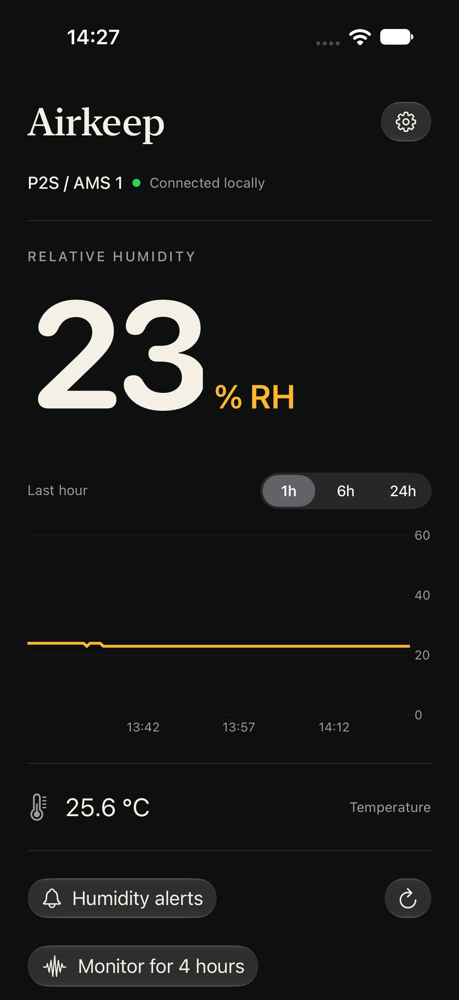
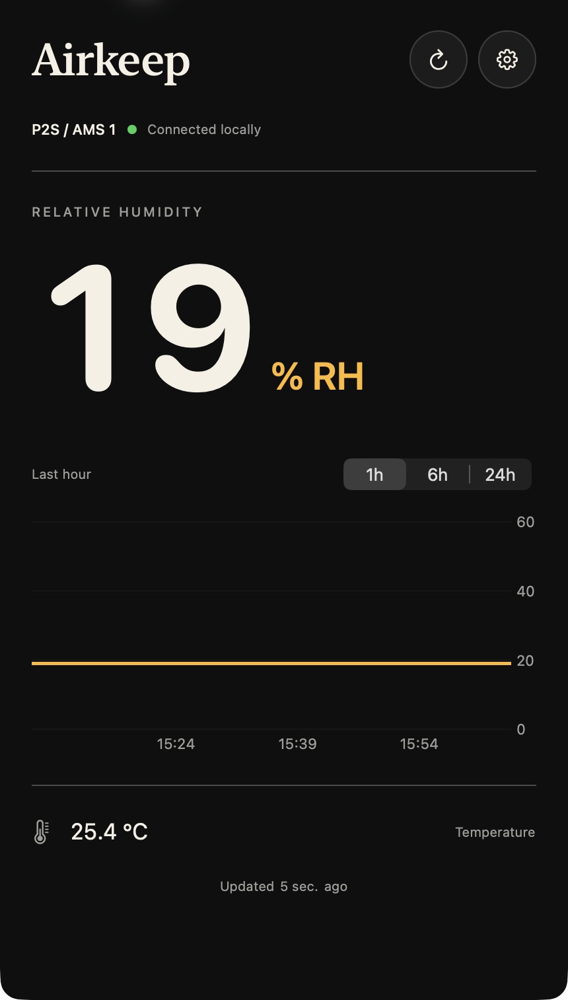
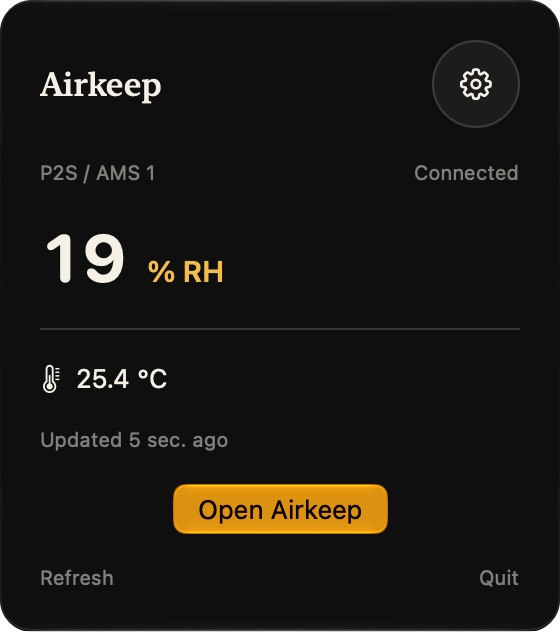
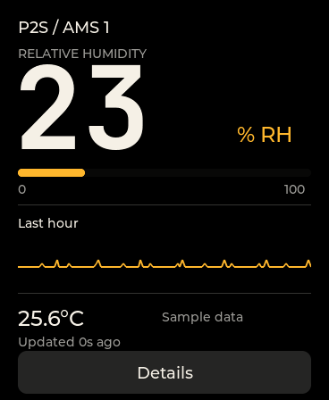

# Airkeep


Airkeep tracks humidity and temperature inside a Bambu Lab P2S's AMS. Check readings and history on an iPhone, iPad or Mac, in the Mac menu bar, through widgets, or on a Waveshare AMOLED desk display. Humidity alerts and iPhone Live Activities help you keep an eye on it while the app is closed.

An always-on relay connects to the printer over local MQTT and serves readings to the apps and display over authenticated HTTPS. Each relay monitors one printer and keeps collecting data when the clients are closed. It sends no printer commands. See the [architecture guide](docs/architecture.md) for the data flow and API behavior.

**AMS humidity measures the air around the filament. It doesn't measure moisture inside a spool or tell you whether it needs drying.**

## Screenshots

| iPhone app | Mac app |
| --- | --- |
|  |  |

| Mac menu bar | ESP32 display UI |
| --- | --- |
|  |  |

## Set up the relay

Run the relay on an always-on host that can reach the printer's LAN. You'll need the printer's address, serial number and LAN access code, plus a bearer token for client access.

Follow [Docker deployment](docs/docker-deployment.md) to configure and start it. The guide covers persistent storage, HTTPS and optional APNs keys. Clients on other devices need a reachable HTTPS address with a trusted certificate. Keep the printer's MQTT port private.

## Build the Apple apps

The apps require iOS/macOS 26+ and Xcode 26+. Copy the local signing template and open the included project:

```sh
cp apple/Local.xcconfig.example apple/Local.xcconfig
open apple/Airkeep.xcodeproj
```

Set your team and bundle prefix in `Local.xcconfig`, then select `Airkeep-iOS` or `Airkeep-macOS`. [Apple setup](docs/apple-setup.md) covers the App Group, Keychain and push entitlements, device signing, and project regeneration with XcodeGen.

In Settings → Relay, enter the relay's HTTPS URL and bearer token. The token is stored in Keychain and shared with the widgets. For a UI preview without a relay, launch with `--demo`.

## Build the desk display

The firmware targets **Waveshare ESP32-S3-Touch-AMOLED-1.8 V2**, with a CO5300 panel and CST820 touch controller. It uses LVGL and an existing ESP-IDF v5.5.x installation. The build helper searches for an installed SDK.

```sh
scripts/idf.sh menuconfig
# Under Airkeep connection, set Wi-Fi, relay HTTPS URL, bearer token and AMS ID.
scripts/idf.sh build
scripts/idf.sh -p /dev/cu.YOUR_BOARD flash monitor
```

The display shows humidity, AMS temperature, reading age and up to an hour of history collected since boot. Tap Details to adjust brightness. [Firmware setup](firmware/README.md) covers the board, networking and host renderer.

Wi-Fi credentials and the relay token are stored in ignored local configuration and compiled firmware. Keep those binaries private.

## Alerts and monitoring

In Settings → Humidity alerts, create named rules for each AMS with their own threshold, hold duration and reset margin. New rules start disabled. Rules sync through the relay across your Apple devices. Cached rules remain readable offline. Each rule sends an alert once its threshold has been sustained and a recovery alert after humidity falls below the reset point. Choose Receive alerts on this device in Settings → Notifications separately on each device.

Remote alerts and background Live Activity updates need an Apple Developer Program account and your own APNs signing keys. Follow [push setup](docs/push-setup.md). Readings, history and widgets work without APNs.

Choose Start Live Activity in Settings → Live Activities on iPhone to show humidity on the Lock Screen and in Dynamic Island on supported iPhones for up to eight hours. The app shows when the session ends. Widget refreshes follow the system's schedule, and push updates can be delayed. Cached readings retain their original timestamps so their age stays visible.

## Development

The relay lives in `server/`, the SwiftUI apps and widgets in `apple/`, and the ESP-IDF/LVGL display code in `firmware/`. To run the relay directly for development, install [uv](https://docs.astral.sh/uv/) and configure `server/.env`:

```sh
cd server
cp .env.example .env
# Set printer credentials and a bearer token. Generate a token with: openssl rand -hex 32
uv sync --locked
uv run uvicorn app:create_app --factory --host 127.0.0.1 --port 8787
```

This listens on loopback. The iPhone simulator can use `http://localhost:8787`. Other devices need the HTTPS route described in the deployment guide.

From the repository root, run relay and notification-state tests and unsigned Apple builds with:

```sh
scripts/check.sh
```

The [firmware guide](firmware/README.md#host-rendering-and-tests) covers LVGL host tests. Device testing is still needed for battery operation, production pushes, long monitoring sessions and native Mac widget placement.

[Brand assets](design/brand/README.md) contain the editable logos, GitHub artwork and native app icon. Airkeep is available under the [MIT license](LICENSE).
