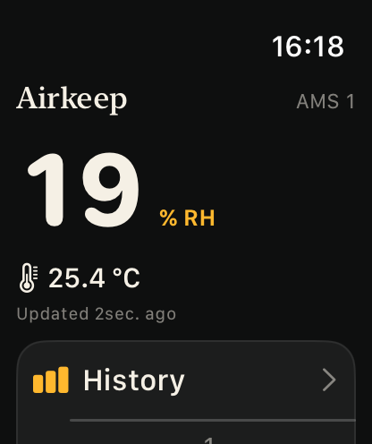
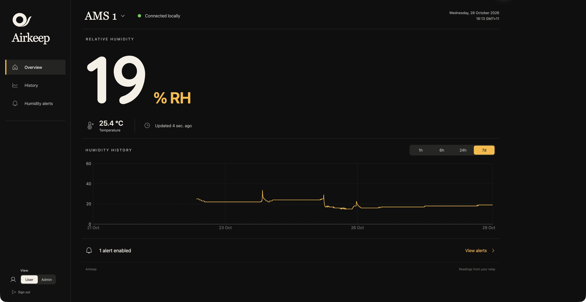

# Airkeep


Airkeep tracks humidity and temperature inside a Bambu Lab P2S's AMS. Check readings and history on your Apple devices, in a browser or on a Waveshare AMOLED desk display. Shared humidity alerts and iPhone Live Activities help you keep an eye on it while the app is closed.

An always-on, self-hosted relay connects to one printer over local MQTT, stores seven days of history and serves readings to every client over authenticated HTTPS. It keeps collecting data and checking alert rules when the clients are closed. See the [architecture guide](docs/architecture.md) for the data flow and relay interfaces.

AMS humidity describes the air around the filament.

## Where to use it

| Client | Features |
| --- | --- |
| iPhone and iPad | Readings, history, shared alert editing and widgets. iPhone also supports Live Activities. |
| Mac | Dashboard, menu-bar readings, widgets, shared alert editing and launch at login. |
| Apple Watch | Readings, 1h / 6h / 24h history, shared alert status, watch-face complications and a Smart Stack widget. Set up through the paired iPhone. |
| Web browser | Readings, 1h / 6h / 24h / 7d history, shared alert editing and a past-alert timeline. Admin view shows relay health, registrations and Apple push activity. |
| ESP32 desk display | Touchscreen readings, reading age, brightness control and up to an hour of history collected since boot. |

## Screenshots

| iPhone app | Mac app |
| --- | --- |
|  |  |

| Apple Watch | ESP32 display | Mac menu bar |
| --- | --- | --- |
|  |  |  |

### Web overview



## Set up the relay

Run the relay on an always-on host that can reach the printer's LAN. You'll need the printer's address, serial number and LAN access code, plus a bearer token for client access.

Follow [Docker deployment](docs/docker-deployment.md) to configure and start it. The guide covers persistent storage, HTTPS and optional APNs keys. Clients on other devices need a reachable HTTPS address with a trusted certificate. Keep the printer's MQTT port private.

## Build the Apple apps

The apps target iOS, iPadOS, macOS and watchOS 26 or later. Build with Xcode 26 or later and the matching platform support. Copy the local signing template and open the included project:

```sh
cp apple/Local.xcconfig.example apple/Local.xcconfig
open apple/Airkeep.xcodeproj
```

Set your team and bundle prefix in `Local.xcconfig`, then select `Airkeep-iOS`, `Airkeep-macOS` or `Airkeep-watchOS`. The iOS app includes the Watch companion. [Apple setup](docs/apple-setup.md) covers signing, shared storage, push entitlements and project regeneration with XcodeGen.

In Settings → Relay, enter the relay's HTTPS URL and bearer token. Credentials are stored in Keychain. For a UI preview, launch with `--demo`.

### Connect Apple Watch

Install Airkeep on the paired Watch, then open Settings → Relay → Apple Watch in the iPhone app and choose Connect Apple Watch. Wait for Connected to appear. On the Watch, add Airkeep through the watch-face complication picker or Smart Stack and choose the AMS to display.

The Watch app fetches directly from the relay, with a reachable-iPhone fallback and cached readings when offline. Complications fetch directly and retain cached readings with their original timestamps. Edit shared alert rules on iPhone, iPad, Mac or the web dashboard; the Watch shows their status.

## Web dashboard

The dashboard is bundled into the relay's Docker image and uses the same HTTPS address. Configure an owner password and browser origin using [web dashboard setup](docs/web-dashboard.md), restart the relay, then sign in. The browser password is separate from the bearer token used by native clients.

Switch between User and Admin views with the same owner account. User view includes shared rules and a seven-day timeline of triggered and recovered alerts. Admin view shows relay health, device subscriptions, Live Activity sessions, Watch widget registrations and recent APNs requests. Manage rules in User view and device subscriptions in each Apple app. Successful push requests are labelled **Accepted by Apple**.

## Build the desk display

The firmware targets **Waveshare ESP32-S3-Touch-AMOLED-1.8 V2**, with a CO5300 panel and CST820 touch controller. It uses LVGL and an existing ESP-IDF v5.5.x installation. The build helper searches for an installed SDK.

```sh
scripts/idf.sh menuconfig
# Under Airkeep connection, set Wi-Fi, relay HTTPS URL, bearer token and AMS ID.
scripts/idf.sh build
scripts/idf.sh -p /dev/cu.YOUR_BOARD flash monitor
```

Tap Details on the display to adjust brightness. [Firmware setup](firmware/README.md) covers the board, networking and host renderer.

Wi-Fi credentials and the relay token are stored in ignored local configuration and compiled firmware. Keep those binaries private.

## Alerts and monitoring

In Settings → Humidity alerts, or Humidity alerts on the web, create named rules for each AMS with their own threshold, hold duration and recovery margin. New rules start disabled. The relay keeps rules in sync across clients and evaluates each independently. Each rule sends an alert once its threshold has been sustained and a recovery alert after humidity falls below the reset point. Cached rules remain readable offline; saving requires a relay connection.

Choose Receive alerts on this device in Settings → Notifications on each iPhone, iPad or Mac that should receive them. Watch notifications follow the paired iPhone's notification settings. Shared rules apply to every subscribed device.

Remote alerts, background Live Activity updates and Watch widget push updates need an Apple Developer Program account and your own APNs signing keys. Follow [push setup](docs/push-setup.md) for alerts and Live Activities, and [Watch widget push setup](docs/web-dashboard.md#watch-widget-updates) for the Watch topic and keys. Readings, history and scheduled widget refreshes work independently of APNs.

Choose Start Live Activity in Settings → Live Activities on iPhone to show humidity on the Lock Screen and in Dynamic Island on supported iPhones for up to eight hours. The app shows when the session ends. Widget refreshes follow the system's schedule, and push updates can be delayed. Cached readings retain their original timestamps so their age stays visible.

## Development

The relay lives in `server/`, the SwiftUI apps and widgets in `apple/`, the browser app in `web/`, and the ESP-IDF/LVGL display code in `firmware/`. To run the relay directly for development, install [uv](https://docs.astral.sh/uv/) and configure `server/.env`:

```sh
cd server
cp .env.example .env
# Set printer credentials and a bearer token. Generate a token with: openssl rand -hex 32
uv sync --locked
uv run uvicorn app:create_app --factory --host 127.0.0.1 --port 8787
```

This listens on loopback. The iPhone simulator can use `http://localhost:8787`. Other devices need the HTTPS route described in the deployment guide.

For browser development, see the [web development guide](docs/web-dashboard.md#local-development). From the repository root, run the checks with uv, Node 22.12 or later, and Xcode with iOS and watchOS simulator support installed:

```sh
scripts/check.sh
```

The script runs relay, web and Apple tests, builds the browser assets, and builds the iOS, Mac and Watch apps without signing. The [firmware guide](firmware/README.md#host-rendering-and-tests) covers LVGL host tests.

[Brand assets](design/brand/README.md) contain the editable logos, GitHub artwork and native app icon. Airkeep is available under the [MIT license](LICENSE).
