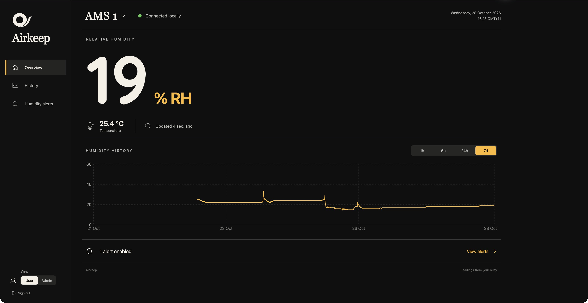
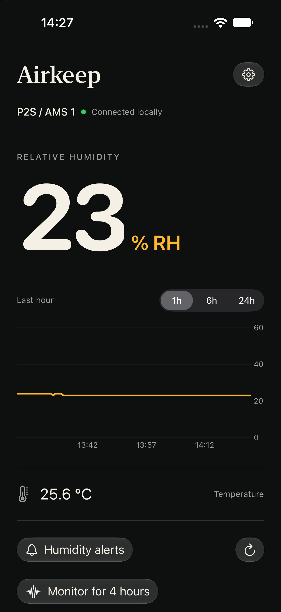
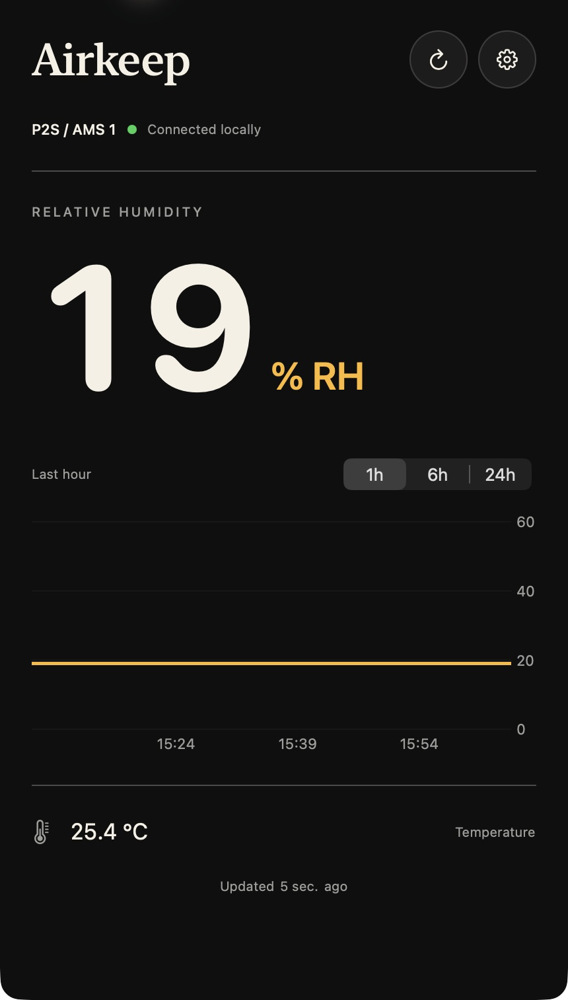
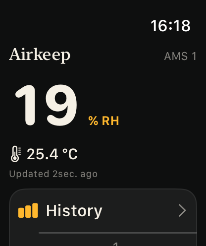
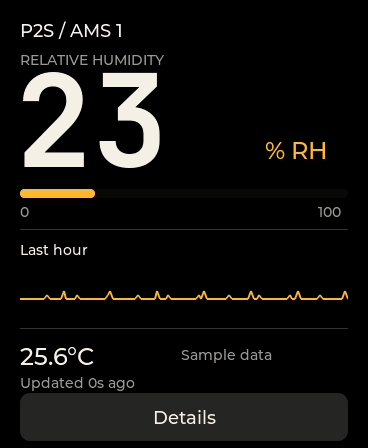
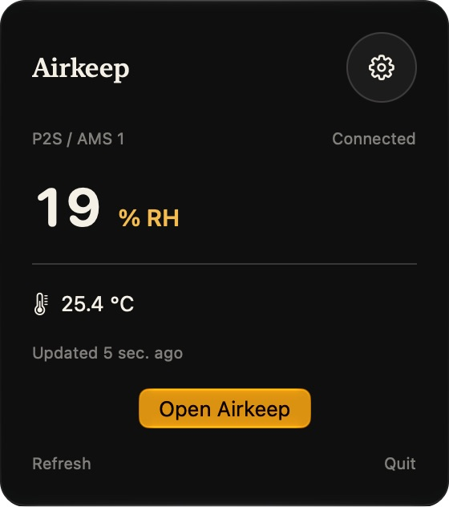

# Airkeep


[Create an Airkeep account](https://dashboard.airkeep.io/signup) · [Sign in](https://dashboard.airkeep.io/) · [Airkeep website](https://airkeep.io/)

Airkeep tracks humidity and temperature inside a Bambu Lab P2S's AMS. Check live readings and seven days of history in a browser, see readings on your Apple devices or on a Waveshare AMOLED desk display, and get alerts when humidity stays high.

## Set up Airkeep

Both setups connect to one printer from an always-on computer on the same network. Have the printer's LAN IP address, serial number and LAN access code ready.

### Use hosted Airkeep

1. [Create an Airkeep account](https://dashboard.airkeep.io/signup) and follow the email link to verify your address and set a password.
2. Start the LAN agent on the printer's network. Run `uvx airkeep` with [uv installed](https://docs.astral.sh/uv/getting-started/installation/), or follow the [Docker setup for Linux](agent/README.md#docker-on-linux). Open the local setup page and enter the printer details.
3. Follow the pairing link, sign in to the dashboard, and approve the code shown in setup.

The [LAN agent](agent/README.md) sends readings to the hosted dashboard and keeps the printer credentials on your network. The hosted service checks alert rules while your apps are closed. Read the [hosted privacy notice](https://airkeep.io/privacy/) for details about account and printer data.

### Self-host with Docker

Follow [Docker deployment](docs/docker-deployment.md) to run your own dashboard and relay. The relay collects readings over local MQTT, stores history, and evaluates alerts. The guide covers account setup, persistent storage, HTTPS and optional APNs keys. Clients on other devices need a reachable HTTPS address with a trusted certificate. Keep the printer's MQTT port private.

See the [architecture guide](docs/architecture.md) and [hosted deployment runbook](docs/hosted-deployment.md) for how the two setups work.

## Where to use it

| Client | Features |
| --- | --- |
| iPhone and iPad | Readings, history, shared alert editing and widgets. iPhone also supports Live Activities. |
| Mac | Dashboard, menu-bar readings, widgets, shared alert editing and launch at login. |
| Apple Watch | Readings, 1h / 6h / 24h history, shared alert status, watch-face complications and a Smart Stack widget. Set up through the paired iPhone. |
| Web browser | Readings, 1h / 6h / 24h / 7d history, shared alert editing and a past-alert timeline. Admin view shows relay health, registrations and Apple push activity. |
| ESP32 desk display | Touchscreen readings, reading age, brightness control and up to an hour of history collected since boot. |

## Screenshots



| iPhone app | Mac app |
| --- | --- |
|  |  |

| Apple Watch | ESP32 display | Mac menu bar |
| --- | --- | --- |
|  |  |  |

## Build the Apple apps

The apps target iOS, iPadOS, macOS and watchOS 26 or later. Build with Xcode 26 or later and the matching platform support. Copy the local signing template and open the included project:

```sh
cp apple/Local.xcconfig.example apple/Local.xcconfig
open apple/Airkeep.xcodeproj
```

Set your team and bundle prefix in `Local.xcconfig`, then select `Airkeep-iOS`, `Airkeep-macOS` or `Airkeep-watchOS`. The iOS app includes the Watch companion. [Apple setup](docs/apple-setup.md) covers signing, shared storage, push entitlements and project regeneration with XcodeGen.

In Settings → Relay, enter `https://dashboard.airkeep.io` for hosted Airkeep or your own relay's HTTPS URL, then sign in. Credentials are stored in Keychain. For a UI preview, launch with `--demo`.

### Connect Apple Watch

Install Airkeep on the paired Watch, then open Settings → Relay → Apple Watch in the iPhone app and choose Connect Apple Watch. Wait for Connected to appear. On the Watch, add Airkeep through the watch-face complication picker or Smart Stack and choose the AMS to display.

The Watch app fetches directly from the relay, with a reachable-iPhone fallback and cached readings when offline. Complications fetch directly and retain cached readings with their original timestamps. Edit your alert rules on iPhone, iPad, Mac or the web dashboard; the Watch shows their status.

## Web dashboard

The self-hosted dashboard runs in an Nginx container alongside the Python backend. Nginx serves the frontend and forwards API requests, so the dashboard and native clients use the same HTTPS address. [Docker deployment](docs/docker-deployment.md) covers the two GHCR images and shared image tags. Create the first administrator using [account setup](docs/docker-deployment.md#accounts-and-sign-in), then sign in with your username and password.

Each user has their own rules and a seven-day timeline of triggered and recovered alerts. On a self-hosted relay, administrators can create accounts and switch to Admin view to see relay health, device subscriptions, Live Activity sessions, Watch widget registrations and recent APNs requests. Manage rules in the dashboard and device subscriptions in each Apple app. Successful push requests are labelled **Accepted by Apple**.

## Install the desk display

The firmware targets **Waveshare ESP32-S3-Touch-AMOLED-1.8 V2**, with a CO5300 panel and CST820 touch controller. Use the [web installer](https://airkeep.io/install/) to flash and configure it over USB. To build from source, use ESP-IDF v5.5.x. The build helper searches for an installed SDK.

```sh
scripts/idf.sh menuconfig
# Under Airkeep connection, set Wi-Fi, relay HTTPS URL and AMS ID.
scripts/idf.sh build
scripts/idf.sh -p /dev/cu.YOUR_BOARD flash monitor
```

Tap **Pair display**, scan the QR code, then sign in to Airkeep and approve the code. Tap **Details** on the display to adjust brightness. [Firmware setup](firmware/README.md) covers the board, networking and host renderer.

USB setup saves Wi-Fi settings on the display. Keep binaries built with Wi-Fi credentials private.

## Alerts and monitoring

In Settings → Humidity alerts, or Humidity alerts on the web, create named rules for each AMS with their own threshold, hold duration and recovery margin. New rules start disabled. The relay keeps rules in sync across clients and evaluates each independently. Each rule sends an alert once its threshold has been sustained and a recovery alert after humidity falls below the reset point. Cached rules remain readable offline; saving requires a relay connection.

Choose Receive alerts on this device in Settings → Notifications on each iPhone, iPad or Mac that should receive them. In the Watch app, open Alerts and enable Receive alerts on this Watch for delivery over Wi-Fi or cellular, even when the iPhone is off. Your rules apply to your subscribed devices.

On a self-hosted relay, remote alerts, background Live Activity updates and Watch widget push updates need an Apple Developer Program account and your own APNs signing keys. Follow [push setup](docs/push-setup.md) for alerts and Live Activities, and [Watch widget push setup](docs/web-dashboard.md#watch-widget-updates) for the Watch topic and keys. Readings, history and scheduled widget refreshes work independently of APNs.

Choose Start Live Activity in Settings → Live Activities on iPhone to show humidity on the Lock Screen and in Dynamic Island on supported iPhones for up to eight hours. The app shows when the session ends. Widget refreshes follow the system's schedule, and push updates can be delayed. Cached readings retain their original timestamps so their age stays visible.

## Development

The relay lives in `server/`, the SwiftUI apps and widgets in `apple/`, the browser app in `web/`, and the ESP-IDF/LVGL display code in `firmware/`. To run the relay directly for development, install [uv](https://docs.astral.sh/uv/) and configure `server/.env`:

```sh
cd server
cp .env.example .env
# Set printer credentials, the HTTPS origin, and a JWT signing key.
uv sync --locked
uv run uvicorn app:create_app --factory --host 127.0.0.1 --port 8787
```

This listens on loopback. The iPhone simulator can use `http://localhost:8787`. Other devices need the HTTPS route described in the deployment guide.

For browser development, see the [web development guide](docs/web-dashboard.md#local-development). From the repository root, run the checks with uv, Node 22.12 or later, and Xcode with iOS and watchOS simulator support installed:

```sh
scripts/check.sh
```

The script runs relay, web and Apple tests, builds the browser assets, and builds the iOS, Mac and Watch apps without signing. The [firmware guide](firmware/README.md#host-rendering-and-tests) covers LVGL host tests.

### Release a version

On a clean release branch, run the version bump and regenerate the lockfiles and Xcode project. Use `patch`, `minor`, or `major` for the intended bump. Assign Apple build numbers separately when preparing app builds.

```sh
uvx bump-my-version==1.8.1 bump minor
uv lock --directory server
npm install --prefix web --package-lock-only --ignore-scripts
xcodegen generate --spec apple/project.yml
uv run --no-project python scripts/check-version.py
```

Commit the version changes and merge the PR. Tag the merged commit with `v` followed by the exact version in `.bumpversion.toml`. For example, for `0.4.0`, replace `<merge-commit>` with the SHA shown on the merged PR.

```sh
git fetch origin main
git tag -a v0.4.0 <merge-commit> -m 'Airkeep 0.4.0'
git push origin v0.4.0
```

The tag triggers publication of the matching relay and dashboard images to GHCR. After **Container images** succeeds, run **Publish Airkeep release** on the same tag with an unused Mac build number. It publishes one GitHub release with the notarized Mac DMG, ESP32 factory firmware, and container digests. GitHub Pages then publishes that firmware and checksum to the web installer. The rolling container `latest` tags track successful builds from `main`. See [release instructions](docs/apple-release.md#publish-a-coordinated-release).

[Brand assets](design/brand/README.md) contain the editable logos, GitHub artwork and native app icon. Airkeep is available under the [MIT license](LICENSE).
