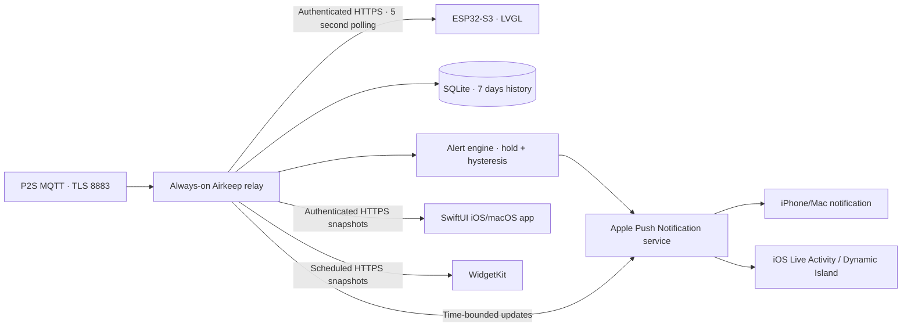

# Architecture

Run the relay on an always-on machine on the printer's LAN, such as a Mac mini, Raspberry Pi or NAS. It needs outbound HTTPS to APNs. For remote app and widget access, give it an authenticated HTTPS route with suitable DNS and routing. Tailscale can provide a private route. A cloud host needs a LAN bridge or VPN to reach the printer.

Only the relay subscribes to the printer's MQTT report topic. The ESP32 and Apple clients share an authenticated HTTPS snapshot API. The board stores no printer IP, serial, LAN access code or Bambu CA bundle. The relay maps `humidity_raw` to percentage, rejects invalid or zero startup readings, and keeps the sample's original timestamp. The raw MQTT index runs in the opposite direction to the UI display level, so no percentage thresholds are inferred from it.

The ESP32 polls every five seconds with the relay bearer token. After NTP synchronization, TLS checks the public certificate chain and hostname. Redirects are rejected to keep the token from reaching another host, and snapshots are limited to 16 KiB. The original UTC sample time maps to the display's monotonic clock using the later of relay time and synchronized local time. Fetching the same sample again leaves its age intact. The relay's `staleAfter` sets when it turns grey. A failed request leaves the last value visible as it ages. The local chart starts at boot.

Every client depends on the relay for fresh readings. If the Docker host stops, clients keep cached data and show its age, while relay-generated notifications stop. Turning off the ESP32 leaves collection, history, alerts and Apple clients running.

The relay stores named rules and their evaluation state independently. Each alert transition creates a delivery job for every subscribed Apple device, with independent retries. Disabling or deleting a rule clears its queued deliveries without sending a recovery. Opting out on one device clears only that device's humidity jobs and leaves Live Activities running. A rotated push token replaces the old registration under the same installation ID. Each Live Activity has its own ID and token. Token rotation doesn't extend its expiry.

SQLite keeps samples at 30-second intervals for seven days and updates the latest sample on each valid AMS report. History queries are limited to 168 hours and 3,000 points. Missing fields in a delta report leave the last known value intact. Clients retain original sample timestamps. The dashboard and alerts judge sensor freshness from that timestamp. Live Activities also allow for their five-minute background update interval: a fresh reading remains current for six minutes after confirmation, while a reading already past the sensor freshness limit is marked out of date immediately. Live Activity freshness never extends beyond the session's end.

The current service is single-user. Its shared bearer token allows reading telemetry, editing shared rules and registering devices. To revoke access, rotate that token and update every client. Separate users and scoped device credentials would need additional access controls.

APNs requests use ES256 tokens over HTTP/2, with separate sandbox and production registrations and Mac/iOS topics. ActivityKit state uses numeric Unix timestamps to avoid the different epoch in Swift's default Date encoding. Notifications contain the AMS identifier, humidity and threshold.

The app and relay both set Live Activity relevance to 50 when creating or updating a session. During device testing, a session with the default score of zero was missing from Dynamic Island. An update with score 50 restored it immediately. Both update paths keep that value so a later push can't reset it to zero. Relevance affects ActivityKit presentation and is separate from APNs delivery priority, which is 5 for background updates.

Rule editors use authenticated `/v2/alerts` endpoints and revision-based `If-Match` checks. A stale revision returns HTTP 412. Clients cache the collection for offline viewing, keep drafts separate and never queue changes. The compact `/v1/snapshot` retains the legacy single-rule projection for the ESP32; full rules are fetched separately. Legacy alert writes return HTTP 409 with `client_update_required`. Existing single-rule databases migrate to Alert 1 with their evaluation state intact.

Device upserts and subscription changes use `/v2/devices/{id}`. Existing registrations migrate to subscribed; new registrations default to off. Token rotation preserves the stored subscription. Device permission, relay subscription and Live Activity update registration are separate states.

## Shared alert API

Every endpoint requires the relay bearer token. Rule responses include `id`, `name`, `revision`, `enabled`, `amsID`, `threshold`, `holdSeconds`, `hysteresis` and the current `active` state.

| Method | Endpoint | Behaviour |
|---|---|---|
| GET | `/v2/alerts` | List all rules and current active states |
| POST | `/v2/alerts` | Create a rule; omitted names use the first unused Alert N |
| GET | `/v2/alerts/{id}` | Read one rule with a revision ETag |
| PUT | `/v2/alerts/{id}` | Update with `If-Match: "<revision>"` |
| DELETE | `/v2/alerts/{id}` | Delete with `If-Match: "<revision>"` |
| PUT | `/v2/devices/{id}` | Upsert a token, platform and environment; `initialReceiveAlerts` applies only to new records |
| PATCH | `/v2/devices/{id}` | Set `receiveAlerts` and return the confirmed subscription |

Updates and deletions return 428 without `If-Match`, 412 for a stale revision and 404 if the rule was removed. Renaming preserves the timer and active state. Condition changes reset only that rule. The apps refresh on activation, when opening Settings and every five seconds while Settings is visible. A conflicting editor keeps its draft and offers Reload latest.
